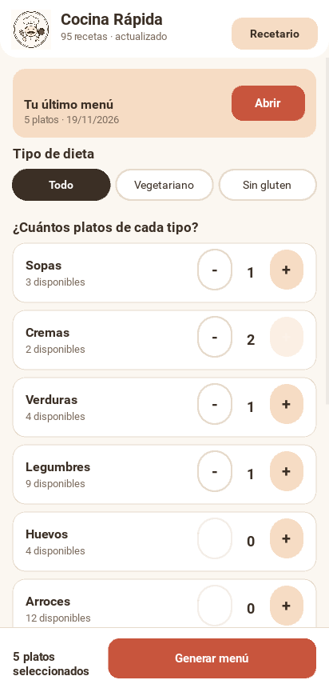
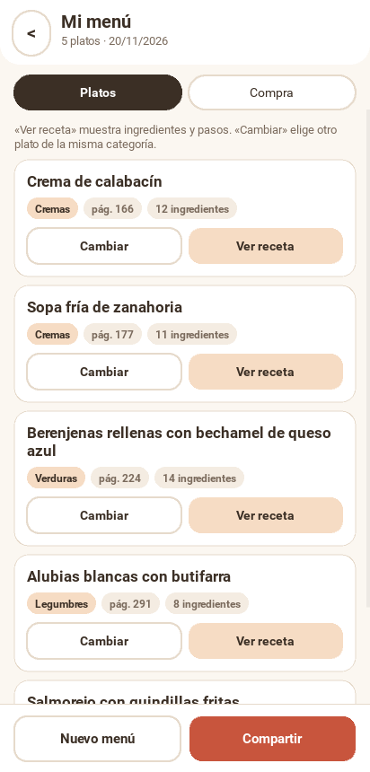
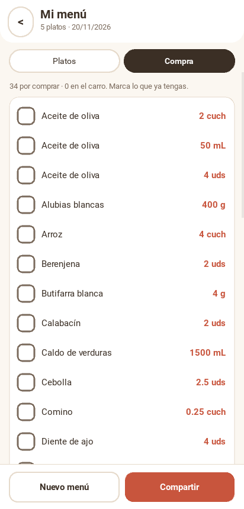
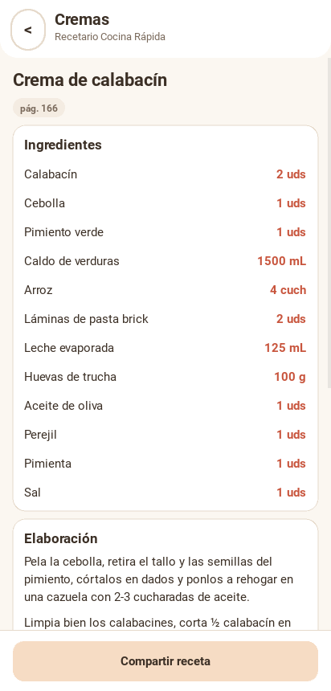
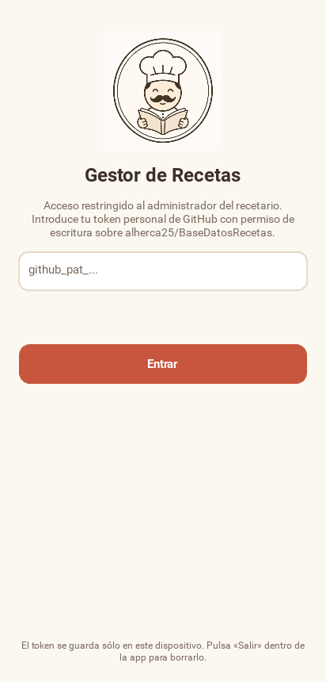
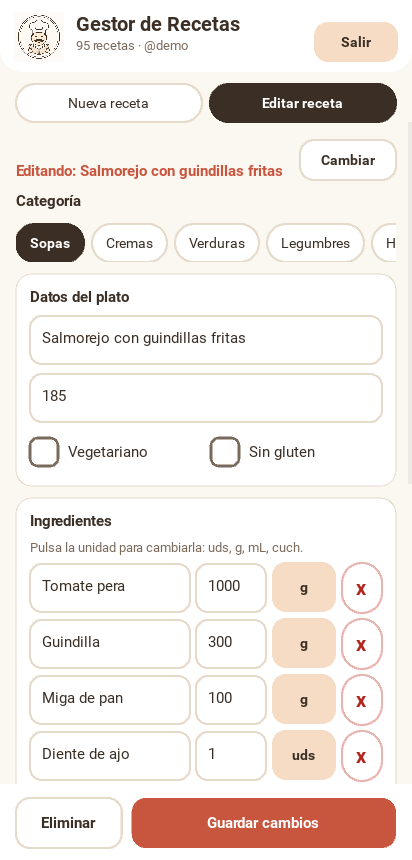

<div align="center">


# Cocina Rápida

**Planificador de menús con lista de la compra, basado en el recetario de Karlos Arguiñano.**


</div>

---

Eliges cuántos platos quieres de cada tipo y **Cocina Rápida** escoge recetas al azar del recetario. Te enseña cada receta y junta los ingredientes de todas en **una sola lista de la compra**, que puedes compartir o exportar a PDF.

El proyecto tiene dos aplicaciones, cada una con versión Android y versión de escritorio:

| App | Para quién | Android | Windows |
|---|---|---|---|
| **Recetario** ([`client/`](client)) | Cualquier usuario (descarga libre) | APK | `.exe` con exportación a PDF |
| **Gestor de Recetas** ([`manager/`](manager)) | Solo el administrador (bloqueado) | APK privado | `.exe` sobre el clon local de la BD |

Las recetas se guardan en un repositorio aparte que solo contiene datos: [**BaseDatosRecetas**](https://github.com/alherca25/BaseDatosRecetas).

## Índice

- [Capturas](#capturas)
- [Funciones](#funciones)
- [Instalación](#instalación)
- [Uso en el ordenador](#uso-en-el-ordenador)
- [Gestor de Recetas: acceso](#gestor-de-recetas-acceso)
- [Compilar](#compilar)
- [Estructura del proyecto](#estructura-del-proyecto)
- [Tests](#tests)
- [Licencia](#licencia)

## Capturas

| Planificar | Mi menú | Lista de la compra | Receta |
|:-:|:-:|:-:|:-:|
|  |  |  |  |

| Gestor: bloqueo | Gestor: editar receta |
|:-:|:-:|
|  |  |

## Funciones

### Recetario
- **Planificar:** cuántos platos quieres de cada categoría y filtros (vegetariano, sin gluten).
- **Mi menú:**
  - *Platos:* puedes cambiar un plato por otro al azar de la misma categoría.
  - *Compra:* la lista de la compra con los ingredientes sumados. Puedes marcar lo que ya tienes y las marcas se guardan.
- **Recetario:** la ficha de cada receta y un buscador por todo el recetario.
- **Sin conexión:** usa la última copia descargada o, si no hay ninguna, la copia que va dentro de la app.
- **Compartir:** en el móvil, el menú y la lista se envían con el menú *Compartir* de Android (WhatsApp, correo…). En escritorio se exportan a PDF.

### Gestor de Recetas
- Añadir, editar, mover de categoría y borrar recetas.
- Valida el nombre, la página y las cantidades, y avisa de recetas duplicadas.
- Guardado seguro: nunca sobrescribe cambios hechos por otra persona y, si falla, no cambia nada.
- En el móvil, una pantalla de bloqueo que solo deja entrar al administrador.

## Instalación

### Android
Descarga el APK del **Recetario** desde [Releases](../../releases). Ábrelo en el móvil, permitiendo «instalar apps desconocidas».

Requiere Android 7.0 o superior en un móvil de 64 bits (arm64-v8a).

### Desde el código

Requisitos: Python 3.11 o superior y Git.

```powershell
git clone https://github.com/alherca25/CocinaArguinyano.git
cd CocinaArguinyano
python -m venv venvArguinyano
venvArguinyano\Scripts\activate
pip install -r requirements_desktop.txt -r requirements_mobile.txt
```

Para usar el Gestor de escritorio, clona también la base de datos **junto a** este repositorio:

```powershell
cd ..
git clone https://github.com/alherca25/BaseDatosRecetas.git
```

## Uso en el ordenador

```powershell
python client\desktop\recetario_desktop.py    # Recetario de escritorio (PDF en Documentos\Cocina Rápida)
python client\mobile\recetario_app.py         # Recetario móvil, en una ventana
python manager\desktop\gestor_desktop.py      # Gestor de escritorio (edita ..\BaseDatosRecetas)
python manager\mobile\gestor_app.py           # Gestor móvil, en una ventana
```

## Gestor de Recetas: acceso

El APK del Gestor **no se publica**. Además, la app está protegida:

- Arranca en una **pantalla de bloqueo** que pide un token de GitHub. Solo deja entrar si el usuario del token tiene **permiso de escritura** sobre `BaseDatosRecetas`, y lo comprueba en cada arranque.
- **Salir** borra el token del móvil.
- Sin un token válido, GitHub rechaza cualquier escritura, aunque alguien consiga el APK.

**Crear el token:**
1. En GitHub, ve a *Settings → Developer settings → Fine-grained tokens → Generate new token*.
2. En *Repository access*, elige solo `BaseDatosRecetas`.
3. En *Permissions → Contents*, elige **Read and write**.

> [!CAUTION]
> El token es una contraseña. Pégalo solo en la pantalla de bloqueo y nunca lo subas a un repositorio.

El Gestor de escritorio no tiene pantalla de bloqueo. Edita tu clon local de la BD, y para publicar los cambios necesitas permiso de *push* (`git push`).

## Compilar

### APK (Android)
Se compila con Buildozer en WSL. La guía completa, con los problemas conocidos y sus soluciones, está en [docs/ANDROID.md](docs/ANDROID.md).

```powershell
.\venvArguinyano\Scripts\python.exe tools\stage_android.py                 # Windows
```
```bash
bash "/mnt/c/Disco D/GitHub/CocinaArguinyano/tools/wsl_build.sh" client    # WSL
bash "/mnt/c/Disco D/GitHub/CocinaArguinyano/tools/wsl_build.sh" manager   # WSL
```

Los APK quedan en `apk/`.

### Ejecutable de Windows (.exe)
```powershell
pip install pyinstaller
pyinstaller client/desktop/recetario.spec --distpath apk --workpath build/pyinstaller
pyinstaller manager/desktop/gestor.spec   --distpath apk --workpath build/pyinstaller
```

### Publicar una versión
Para publicar una versión del Recetario, crea y sube una etiqueta:

```bash
git tag v1.1.0 && git push --tags
```

El workflow [`client.yml`](.github/workflows/client.yml) compila el APK y crea la *Release*. Necesita GitHub Actions activo en la cuenta; si no lo está, sube el APK a mano en *Releases*.

## Estructura del proyecto

```
├── client/                       Recetario (público)
│   ├── mobile/recetario_app.py     app Kivy → APK
│   ├── desktop/recetario_desktop.py app customtkinter → .exe
│   └── buildozer.spec
├── manager/                      Gestor de Recetas (privado)
│   ├── mobile/gestor_app.py        app Kivy con pantalla de bloqueo → APK
│   ├── desktop/gestor_desktop.py   app customtkinter → .exe
│   └── buildozer.spec
├── shared/                       código y recursos comunes
│   ├── functions.py                datos, caché, filtros, menú, lista de la compra, API de GitHub
│   ├── mobile_ui.py                componentes visuales Kivy
│   ├── desktop_theme.py            tema customtkinter
│   ├── assets/                     logos e iconos
│   └── data/                       copia de la BD para arrancar sin conexión
├── tools/                        preparar y compilar APK, iconos, capturas
├── tests/                        tests de la lógica
├── docs/                         ANDROID.md · CHECKLIST.md · screenshots/
└── .github/workflows/            CI: client.yml · manager.yml · build-apk.yml
```

**Tecnologías:**
- [Kivy](https://kivy.org) para las apps móviles;
- [Buildozer](https://github.com/kivy/buildozer) y python-for-android para generar los APK;
- [customtkinter](https://github.com/TomSchimansky/CustomTkinter) para las apps de escritorio;
- [ReportLab](https://www.reportlab.com) para los PDF;
- [PyInstaller](https://pyinstaller.org) para los `.exe`.

## Tests

```powershell
python -m unittest discover -s tests
```

## Licencia

Proyecto de uso personal y educativo. Las recetas pertenecen a sus autores.
